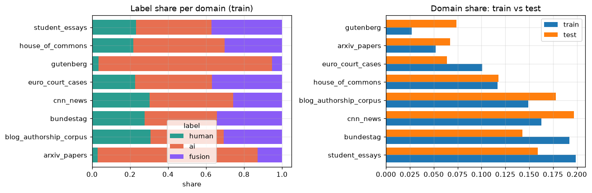
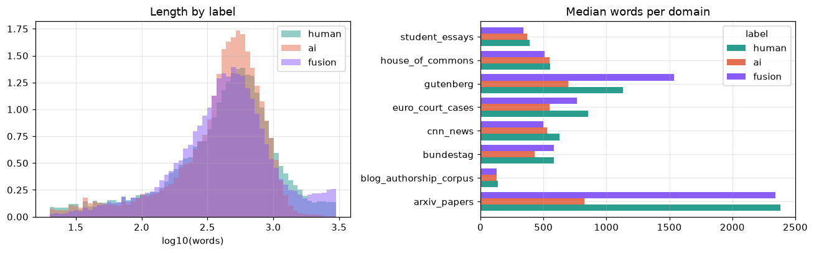
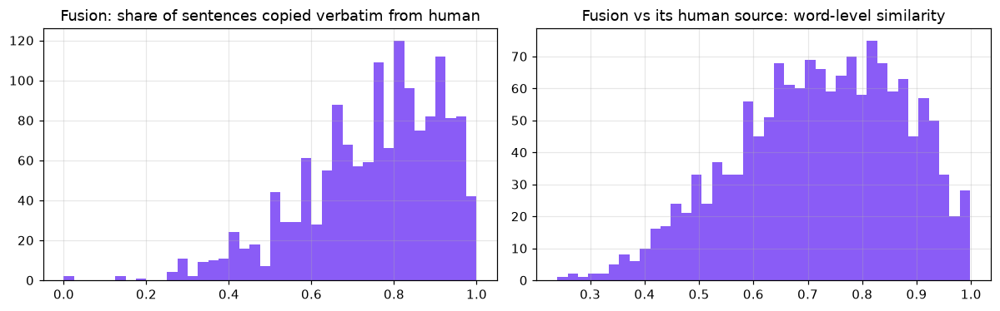
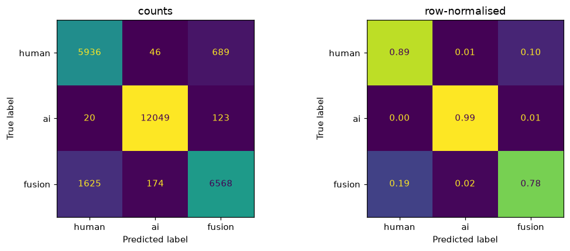
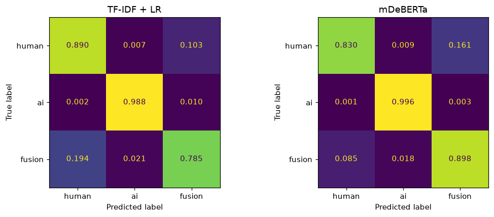

## Task

Each text must get one of 3 labels:

- **human**: written by a person,
- **ai**: fully written by an LLM,
- **fusion**: a human text where a part was removed and an LLM wrote the missing part.

The texts are in English and German, from 8 domains (news, blogs, student essays, Bundestag speeches, court cases, arXiv papers, books and others). The metric is macro-F1, so every class has the same weight.

The main problem: a fusion text is mostly human text with only some parts written by AI, so it is easy to mix it up with human.

## 1. Data (EDA)

Notebook: `notebooks/01_eda.ipynb`.

- **Size.** Train has 272,352 texts. Test has 25,000 texts.
- **Classes.** ai 45%, fusion 31%, human 25%. Not very balanced, but not extreme.
- **Balance depends a lot on the domain.** arXiv and Gutenberg books are 85–92% ai, with very few human and fusion texts. Blogs and Bundestag are almost balanced. German is only in Bundestag (and a few books), so language and domain are mixed together.
- **Test is a bit different from train.** Test has more Gutenberg (7.4% vs 2.7%) and arXiv (6.7% vs 5.2%). These are exactly the domains with the fewest human and fusion examples. Domain and language are given in test, so I use them as features later.

- **Length.** AI texts are rarely longer than ~1000 words. Human and fusion texts go up to 3000 words. Length alone is a weak signal, but a very long text is almost never ai.

- **Texts are long for an encoder.** 68% of texts are longer than 510 tokens, and 51% of all tokens are after the first 510. So if I just cut the text (truncation), half of the information is lost. This is the reason for the "windows" in section 4.
- **What fusion looks like.** I matched fusion texts to their human source (section 2). On average 75% of the fusion sentences are copied from the human text without changes, and word-level similarity is 0.72. The changed parts come in blocks. So a fusion text is "locally human" and "locally AI". A short piece of it can look 100% human.

- **Leaked prompts.** Sometimes the LLM answer leaked into the fusion text, for example *"Here is the reconstructed missing section, approximately 28 words..."* or *"Word Count: 28 words"*. This shows how fusion was made: the middle of a human text was removed and the LLM filled the gap. But this happens in only ~5% of fusion texts, so it is not the main signal.
- **Style differences.** AI texts have more regular sentence lengths, longer words, more em-dashes (—) and curly quotes, and more "LLM words" (*furthermore*, *crucial*). Fusion is between human and ai on almost every statistic. Fusion also has the biggest change of style between 60-word blocks inside one text, which is what I expected from a mix.

## 2. Validation

Code: `src/groups.py`, `src/split.py`.

The data card says that a human text and its AI / fusion versions are always on the same side of the split, but there is no group id. If I split randomly, a human text can be in train and its fusion copy in val. Then the model just remembers the human text, and the val score is too high.

So I rebuilt the groups myself:

1. TF-IDF vectors for texts inside each domain.
2. For each text, 10 nearest neighbors by cosine similarity.
3. Pairs with cosine > 0.4 are joined into one group (union-find).

Most fusion texts form a pair with exactly one human text. AI texts are almost always alone, because the LLM writes them from scratch and they share few words with the source.

Then I used a 10-fold StratifiedGroupKFold (groups from above, strata = domain × label). **Fold 0 (27,230 texts) is the fixed validation set** for all experiments. There are 0 groups shared between val and train.

To keep experiments fast on one RTX 5060 (8 GB), most models are first trained on a fixed 50k subsample of the train folds. The best ones are then trained on 150k or on all ~245k texts.

## 3. Baseline: TF-IDF + linear models

Notebook: `notebooks/02_baseline.ipynb`. Code: `src/baseline.py`.

The TF-IDF vectorizer is inside an sklearn `Pipeline` and is fit only on train texts, so there is no data leak. Word n-grams keep case and punctuation, because these are style signals. Char n-grams are 2–5.

| Features | Model | macro-F1 | F1 human | F1 ai | F1 fusion | time, s |
|---|---|---|---|---|---|---|
| word 1-2 | Naive Bayes | 0.729 | 0.703 | 0.923 | 0.560 | 85 |
| word 1-2 | Linear SVM | 0.870 | 0.815 | 0.987 | 0.807 | 87 |
| char 2-5 | LogReg C=16 | 0.881 | 0.826 | 0.983 | 0.833 | 485 |
| word 1-2 | LogReg C=16 | 0.883 | 0.830 | 0.986 | 0.834 | 105 |
| **word 1-3** | **LogReg C=16** | **0.884** | 0.833 | 0.985 | 0.834 | 258 |
| word + char | Linear SVM C=1 | 0.888 | 0.839 | 0.989 | 0.837 | 668 |

- LogReg and SVM are very close (~0.5 pt).
- Word + char is the best, but only +0.004 and 2.5 times slower.
- Naive Bayes is much worse. It treats n-grams as independent, but n-grams are strongly correlated, so it counts the same evidence many times.
- I chose **word 1-3 + LogReg** as the baseline: almost the best, simple, and its weights are easy to explain (section 7).

- **AI is almost solved** (F1 0.985).
- **Almost all errors are human ↔ fusion.** Fusion is mostly copied human text, so a bag of n-grams sees mostly "human" evidence.
- **By domain**, the worst are blogs (0.77) and Gutenberg books (0.78). The best is Bundestag (0.93).
- **More data helps.** The same pipeline on all ~245k texts instead of 50k: 0.884 → **0.903**.

## 4. Fine-tuned encoders

Notebook: `notebooks/03_encoder.ipynb`. Code: `src/train_encoder.py`.

I fine-tuned two multilingual encoders (they need to know German):

- **mDeBERTa-v3-base**,
- **XLM-RoBERTa-base**.

Setup: AdamW, lr 2e-5 (3e-5 for XLM-R), 6% warm-up then linear decay, effective batch 16, 2 epochs, bf16. In mDeBERTa I froze the embedding matrix (250k tokens). It is 2/3 of all weights, and freezing it saves ~3 GB, so the model fits into 8 GB of GPU memory. One run on 50k texts takes about 1 hour.

### 4.1 Long texts

An encoder reads at most 512 tokens, but half of the tokens are after that.

- **Training:** in every epoch I take a random 510-token window from each text. This is a cheap augmentation, and the model sees all parts of the documents.
- **Inference:** I cut the text into overlapping windows (510 tokens, step 384, max 8 windows) and combine the predictions.

| Model | first window only | head + tail | mean over windows | geometric mean |
|---|---|---|---|---|
| mDeBERTa (50k) | 0.856 | 0.903 | 0.910 | **0.916** |
| XLM-R (50k) | 0.865 | 0.906 | 0.906 | **0.914** |
| XLM-R (50k), trained on first window only | 0.869 | 0.894 | 0.887 | 0.891 |
| mDeBERTa (150k) | 0.880 | 0.934 | 0.934 | **0.947** |
| XLM-R (150k) | 0.884 | 0.926 | 0.925 | **0.933** |
| XLM-R (all 245k) | 0.891 | 0.937 | 0.931 | **0.944** |

- Using all windows instead of only the first one gives **+0.05–0.06**. This is the biggest single improvement in the encoder part.
- Geometric mean is a bit better than the normal mean. One very confident window (for example, a clearly AI part of a fusion text) has more effect.
- The "first window only" model shows why random windows in training matter. It is good on the first window, but much worse when I average over windows, because it never saw the middle and end of texts.
- More data helps a lot: 50k → 150k gives +0.02–0.03.

### 4.2 Encoder vs baseline

Same 50k training data, same val:

| Model | macro-F1 | F1 human | F1 ai | F1 fusion |
|---|---|---|---|---|
| TF-IDF word 1-3 + LogReg | 0.884 | 0.833 | 0.985 | 0.834 |
| mDeBERTa, mean over windows | **0.910** | **0.857** | **0.990** | **0.884** |

- The encoder is better, mostly on fusion (+0.05).
- **But by domain it is not always better.** On arXiv the encoder gets only 0.62, while TF-IDF gets 0.92. arXiv has very few human/fusion examples, and the encoder did not learn them well. On news and blogs the encoder is much better (0.97 vs 0.87 on CNN).
- **They make different mistakes.** On val, 1,881 texts are correct only by the encoder, and 1,239 only by TF-IDF. If we could always pick the right one, the accuracy would be 0.971. This is the reason to combine them (section 6).

## 5. Extra hand-made features

### 5.1 Stylometry

Code: `src/stylometry.py`. About 60 features, CPU only:

- sentence and word lengths, their variation,
- punctuation and typography (em-dash, curly quotes, space before punctuation, ...),
- vocabulary richness (type-token ratio),
- typical LLM words (*furthermore*, *crucial*, *delve*, *insbesondere*, ...),
- **inconsistency features**: the same statistics on 60-word blocks, and how much they change inside the text. This is for fusion.

LightGBM on these features alone: **0.834**. The most important features are mean word length, variation of sentence length, share of non-ASCII characters (curly quotes, dashes) and digits.

### 5.2 Perplexity from an LLM

Code: `src/ppl.py`.

The idea: an LLM finds AI text "more predictable" than human text. I ran Qwen2.5-1.5B (it knows German) on the first 512 tokens and took for each token its log-probability and the entropy of the prediction. From this I built features: mean / std / percentiles of log-prob, entropy, the Fast-DetectGPT score, and the spread of these numbers over 64-token segments (again for fusion).

| Features | macro-F1 |
|---|---|
| perplexity only | 0.687 |
| stylometry only | 0.834 |
| perplexity + stylometry | 0.852 |

Perplexity alone is weak, especially for fusion (F1 0.58). It took 2 hours of GPU time, and in the final stack it did not help (0.9533 with it vs 0.9538 without). So I did not use it in the final model.

## 6. Final model: stacking

Code: `src/stack.py`.

The models from sections 3–5 are "level 1". A LightGBM model on top of them is "level 2".

- **Inputs** (about 110 features):
  - for each encoder: the probabilities from all windows aggregated as mean, max, min, std, first window, last window, and the number of windows,
  - TF-IDF + LogReg probabilities (trained on all train folds),
  - stylometry features,
  - domain and language.
- **Training.** The level-1 models never saw the val fold. So I train the level-2 model on val (27k texts) with a 5-fold StratifiedGroupKFold *inside* val, and report the out-of-fold score. The final level-2 model is trained on all of val and applied to test.

| Stack | val macro-F1 (OOF) |
|---|---|
| mDeBERTa (50k) + TF-IDF + stylometry | 0.950 |
| + XLM-R (50k) | 0.954 |
| + perplexity | 0.953 |
| mDeBERTa (150k) + XLM-R (50k) + TF-IDF + stylometry | 0.964 |
| mDeBERTa (150k) + XLM-R (150k) + TF-IDF + stylometry | 0.967 |
| all 4 encoders + TF-IDF + stylometry | 0.967 |
| **mDeBERTa (150k) + XLM-R (all 245k) + TF-IDF + stylometry** | **0.968** |

- The stack gives a big jump: from 0.947 (best single encoder) to 0.968.
- The most important features are **min P(human) over windows** and **max P(fusion) over windows**. This makes sense: if at least one window looks non-human, the text is probably not fully human. This is exactly the "locally AI" idea from the EDA.
- Adding the old 50k encoders to the 150k ones did not help (0.967 → 0.967).

**Class bias tuning.** I also tried adding a bias to each class log-probability to maximize macro-F1. To check it honestly I chose the biases on one half of val and tested on the other half. The result did not change (0.9681 → 0.9680), so I did not use it.

**Final F1 per class** (best stack): human 0.949, ai 0.997, fusion 0.958.

## 7. Kaggle results

| Submission | val macro-F1 | public | private |
|---|---|---|---|
| TF-IDF word 1-3 + LogReg (50k) | 0.884 | 0.868 | 0.866 |
| Stack: mDeBERTa (50k) + TF-IDF + stylometry | 0.950 | 0.952 | 0.947 |
| Stack: + XLM-R (50k) | 0.954 | 0.957 | 0.953 |
| Stack: mDeBERTa (150k) + XLM-R (150k) | 0.967 | 0.969 | 0.966 |
| **Stack: mDeBERTa (150k) + XLM-R (all)** | **0.968** | **0.970** | **0.970** |

- Val, public and private scores are very close and go up together. So my grouped validation is a good copy of the test.
- The baseline is a bit lower on public than on val. Test has more arXiv and Gutenberg, where the baseline is weak on fusion.

## 8. Bonus: explainability

Code: `src/xai.py`.

### 8.1 TF-IDF + LogReg: which n-grams matter

The largest weights per class:

- **human:** *"Vielen Dank"*, *"Herzlichen Dank"* (end of real Bundestag speeches), *urlLink* and *STUDENT_NAME* (artifacts of the original datasets), *CNN*, *"In conclusion"*.
- **ai:** straight quotes `"`, `!`, `?`, curly apostrophes, *significant*, *within*, and informal words like *gotta*, *kinda*, *feels* (the LLM was asked to imitate blog style and overdid it).
- **fusion:** *"…"*, *". and"*, *"Let me know"*, *crucial*, *Furthermore*. *"Let me know if..."* is clearly a piece of an LLM chat answer that leaked into the text. *". and"* is a broken join between human and AI parts.

So part of what the baseline learns is not "style" but artifacts of how the dataset was made.

### 8.2 Integrated Gradients on mDeBERTa

I implemented Integrated Gradients myself (16 steps, baseline = all-[PAD] embeddings) and merged subword scores into words.

- **human:** *according*, *could*, *which*, *because*, German *dass*, *auch*, *Kollegen!* — normal function words and the speech style of the Bundestag.
- **ai:** *particularly*, *significant*, *dear*, *let*, *I'm*, *Herren,* — typical LLM openings like *"Sehr geehrte Damen und Herren,"* and *"Let me..."*.
- **fusion:** a lot of attribution goes to the special tokens `[SEP]`, `[CLS]` and to punctuation. The model seems to use them to collect information about the whole window, not single words.

### 8.3 Does the encoder find the AI part of a fusion text?

For val fusion texts whose human source is also in val, I know exactly which words the LLM wrote (alignment with `difflib`). I moved a 128-token window over the text and compared the share of LLM-written words in the window with the encoder prediction for this window.

| LLM-written share in window | P(human) | P(ai) | P(fusion) | windows |
|---|---|---|---|---|
| 0–5% | **0.61** | 0.05 | 0.34 | 2,303 |
| 5–25% | 0.11 | 0.04 | **0.85** | 240 |
| 25–50% | 0.03 | 0.05 | **0.92** | 173 |
| 50–75% | 0.04 | 0.15 | **0.81** | 183 |
| 75–95% | 0.23 | 0.20 | **0.57** | 276 |
| 95–100% | 0.15 | 0.40 | **0.45** | 716 |

Spearman correlation between the LLM share and P(human) is **−0.63**.

- Windows with only human text are mostly predicted as human.
- Windows with a **border** between human and AI text (5–75%) are predicted as fusion with high confidence. So the model learned to see the "join".
- Windows that are fully AI-written are split between ai and fusion.

This explains why min P(human) and max P(fusion) over windows are the best stack features.

## 9. Conclusions

1. Validation must be split by groups. A human text and its fusion copy must not be on different sides of the split.
2. Long texts must be read fully: random windows in training and averaging over all windows in inference gave +0.05–0.06.
3. Fusion is the hard class. It is "locally human, locally AI", and the per-window statistics (min / max over windows) are the best way to catch it.
4. TF-IDF and encoders make different mistakes, so the stack is much better than each model alone (0.947 → 0.968).
5. More training data helped at every step (50k → 150k → 245k).
6. Perplexity features from an LLM were weak and did not help in the stack.

Next steps: train mDeBERTa on all data, try a bigger encoder (large), and try to predict which words are AI-written (token classification), since this is how fusion is really made.

## Code

- `notebooks/01_eda.ipynb`: data analysis.
- `notebooks/02_baseline.ipynb`: TF-IDF baseline, parameter search, errors, per-domain scores.
- `notebooks/03_encoder.ipynb`: encoders, long-text handling, comparison with the baseline.
- `src/`: groups and split (`groups.py`, `split.py`), baseline (`baseline.py`), encoders (`train_encoder.py`), stylometry (`stylometry.py`), perplexity (`ppl.py`), stacking (`stack.py`), explainability (`xai.py`).
- `scripts/queue_*.sh`: commands for all runs.
